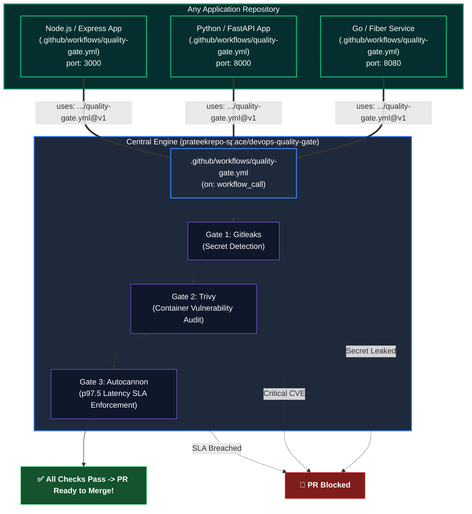

# DevOps Quality Gate

> **An automated, zero-cost DevSecOps quality gate for GitHub Actions. Blocks hardcoded secrets (Gitleaks), critical container vulnerabilities (Trivy), and latency regressions (Autocannon p97.5 SLA) before bad code can merge into production.**

[](#how-to-use-this-in-your-own-project)
[](https://github.com/gitleaks/gitleaks-action)
[](https://github.com/aquasecurity/trivy)
[](https://github.com/mcollina/autocannon)
[](#why-it-is-100-free)

---

## Introduction & Scope

Standard continuous integration (CI) pipelines only test if code runs functionally (e.g., returning HTTP 200). They silently allow critical security vulnerabilities, leaked credentials, and severe speed slowdowns to reach production.

**DevOps Quality Gate** acts as an automated quality bouncer for your repositories. It runs in GitHub Actions as a centralized **Reusable Workflow (`workflow_call`)** that inspects your application across three automated gates before allowing a Pull Request to merge.

* **Language-Agnostic:** Works with any language or framework (Node.js, Python, Go, Java, Rust, PHP) that packages into a Docker container.
* **100% Free:** Runs entirely on GitHub-hosted `ubuntu-latest` runners. No cloud accounts, AWS keys, or credit cards required.

---

## How It Works (The 3 Quality Gates)

Every time a Pull Request is opened in a connected repository, GitHub Actions runs these checks in sequence:

```
[PR Opened] ──> [Gate 1: Secret Scan] ──> [Gate 2: Container Security] ──> [Gate 3: Load & SLA Gate] ──> [Merge Approved]
                        │                               │                              │
                     Leaked Key?                    Critical CVE?                 p97.5 > 300ms?
                        ▼                               ▼                              ▼
                   🛑 Block PR                     🛑 Block PR                    🛑 Block PR
```

1. **Gate 1: Secret Scanning ([Gitleaks](https://github.com/gitleaks/gitleaks-action))**  
   Scans the entire Git commit history to ensure no API keys, private tokens, passwords, or certificates are accidentally committed.
2. **Gate 2: Container Security ([Trivy](https://github.com/aquasecurity/trivy))**  
   Builds the application's Docker image and scans operating system packages and dependencies. Blocks the build if any `CRITICAL` CVEs are found.
3. **Gate 3: Load-Testing Performance Gate ([Autocannon](https://github.com/mcollina/autocannon))**  
   Spins up an ephemeral container on the runner, waits for the `/health` endpoint, and benchmarks the API under load (default: 30 concurrent users for 10 seconds). Fails if any requests error out or if the **p97.5 tail latency exceeds the configured SLA** (default: 300ms). Cleans up the container automatically.

---

## Architecture



---

## How to Use This in Your Own Project

You can plug this quality gate into **any GitHub repository** that has a `Dockerfile` in 30 seconds.

### Step 1: Create the Workflow File
In your repository, create `.github/workflows/quality-gate.yml`:

```yaml
name: Quality Gate

on: [push, pull_request]

jobs:
  quality-gate:
    name: "Enforce Security & Performance SLA"
    uses: prateekrepo-space/devops-quality-gate/.github/workflows/quality-gate.yml@v1
    with:
      port: "8000"              # Your container's listening port (e.g., 3000, 8000, 8080)
      health_path: "/health"    # Health check route used for container readiness
      load_test_path: "/items"  # API route to benchmark under load
      max_latency_ms: 300       # SLA limit: Fails PR if p97.5 latency > 300ms
```

### Step 2: Open a Pull Request
Whenever code is pushed or a PR is opened, the 3 gates run automatically. If an API endpoint regresses or secrets are detected, the check fails with a red ❌ and blocks the merge.

---

## Configurable Options

You can customize the gate parameters for your specific application requirements:

| Input | Description | Type | Default | Example |
| :--- | :--- | :---: | :---: | :---: |
| `port` | Container listening port | `string` | `"8000"` | `"3000"`, `"8080"` |
| `health_path` | Endpoint to verify container readiness | `string` | `"/health"` | `"/api/health"` |
| `load_test_path` | Route to benchmark under traffic | `string` | `"/items"` | `"/api/users"` |
| `max_latency_ms` | Maximum acceptable p97.5 latency in ms | `number` | `300` | `150` (strict) or `500` |
| `connections` | Number of simultaneous concurrent users | `number` | `30` | `10`, `50`, `100` |
| `duration` | Benchmark duration in seconds | `number` | `10` | `5` or `20` |

---

## Local Development & Testing

This repository includes a production-grade Python 3.12 FastAPI microservice so you can test all quality gates locally.

### 1. Run Unit Tests
```bash
pip install -r app/requirements.txt
pytest -v tests/
```

### 2. Build & Run the Container
The container runs as an unprivileged user (`appuser`, UID 10001) for defense-in-depth:
```bash
# Build image
docker build -t demo-api:local .

# Run container on port 8000
docker run -d --name demo-api -p 8000:8000 demo-api:local

# Check health endpoint
curl http://localhost:8000/health

# Clean up
docker stop demo-api && docker rm demo-api
```

### 3. Run Autocannon Load Benchmark Locally
```bash
# Ensure container or local app is running on port 8000
npx --yes autocannon -c 30 -d 10 http://localhost:8000/items
```

---

## Repository Structure

```plaintext
.
├── .github/
│   └── workflows/
│       ├── quality-gate.yml   # The reusable quality gate engine (on: workflow_call)
│       └── ci-cd.yml          # Self-test pipeline for the included FastAPI app
├── app/
│   ├── main.py                # FastAPI service with /health & /items endpoints
│   └── requirements.txt       # Dependencies (fastapi, uvicorn, pydantic, pytest)
├── tests/
│   └── test_app.py            # Unit tests covering endpoints and latency logic
├── examples/
│   └── quality-gate.yml       # Copy-paste starter template for other projects
├── Dockerfile                 # Hardened python:3.12-slim image running as non-root user
├── .dockerignore              # Cache, test, and git exclusions
├── pytest.ini                 # Pytest root configuration
├── .gitignore                 # Python, test, OS, and local credential ignores
└── README.md                  # Project documentation
```
