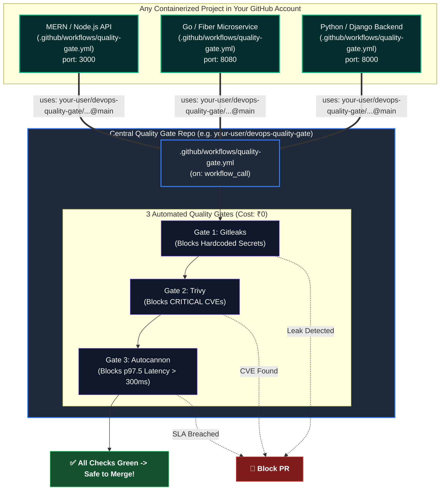

# Free CI Security & Load-Testing Quality Gate for Any Repo

> **100% Free (₹0 / $0 Forever) DevSecOps & Platform Engineering Quality Gate for GitHub Actions. Blocks hardcoded secrets (Gitleaks), critical container vulnerabilities (Trivy), and latency regressions (Autocannon p97.5 SLA) before bad code can merge—with zero cloud infrastructure or AWS account required.**

[](#how-to-wire-this-quality-gate-to-any-repo-in-30-seconds)
[](https://github.com/aquasecurity/trivy)
[](https://github.com/mcollina/autocannon)
[](#why-it-costs-0-forever)

---

## What Is This?

This project is an **automated quality bouncer** that runs on GitHub Actions. It acts as a central **Reusable Workflow (`workflow_call`)** that any of your repositories (Node.js, Python, Go, Java, Rust) can plug into with **just 10 lines of YAML**.

Every time a developer opens a Pull Request in any connected repo, GitHub spins up an ephemeral runner and tests three critical gates before code can merge:

1. **Secret Scanning ([Gitleaks](https://github.com/gitleaks/gitleaks-action)):** Scans the entire git history to catch leaked API keys, tokens, or passwords.
2. **Container Security ([Trivy](https://trivy.dev/)):** Builds your Docker image and fails if it finds `CRITICAL` operating system or library CVEs.
3. **Speed & SLA Gate ([Autocannon](https://github.com/mcollina/autocannon)):** Starts your container on the runner, verifies `/health`, and hammers your API route with 30 concurrent users for 10 seconds. If any request fails or `p97.5 latency > 300ms`, the PR turns red and blocks the merge.

---

## Architecture: Central Engine & Consumer Repositories



---

## Why It Costs ₹0 Forever

- **No Cloud Accounts Needed:** Zero AWS, GCP, or Azure accounts or credit cards required.
- **GitHub Runner Powered:** Executes entirely on GitHub’s free, ephemeral `ubuntu-latest` virtual machines.
- **Public Reusable Workflows:** GitHub provides 100% free GitHub Actions minutes for public repositories.

---

## How to Wire This Quality Gate to ANY Repo in 30 Seconds

### Step 1: Make This Central Repo Public
Ensure your copy of this repository on GitHub is set to **Public** so your other repositories can call the workflow.

### Step 2: Add 10 Lines of YAML to Your Target Repo
In **any** other application repository that has a `Dockerfile`, create `.github/workflows/quality-gate.yml`:

```yaml
name: Run Quality Gate

on:
  push:
    branches: [ "main" ]
  pull_request:
    branches: [ "main" ]

jobs:
  gate:
    name: "Enforce Quality Gate"
    # Uses your public quality gate:
    uses: prateekrepo-space/devops-quality-gate/.github/workflows/quality-gate.yml@main
    with:
      port: "8000"              # Your app container port (e.g., 3000 for Node, 8080 for Go)
      health_path: "/health"    # Route used to verify container readiness
      load_test_path: "/items"  # Route to test under load (e.g., /api, /users)
      max_latency_ms: 300       # SLA limit: Fails PR if p97.5 latency > 300ms
      connections: 30           # Number of concurrent users (default: 30)
      duration: 10              # Benchmark duration in seconds (default: 10)
```

That's it! Every future Pull Request in that repository now automatically runs Gitleaks, Trivy, and Autocannon before merging.

---

## Repository Structure

```plaintext
.
├── .github/
│   └── workflows/
│       ├── quality-gate.yml   # Central Reusable Workflow engine (on: workflow_call)
│       └── ci-cd.yml          # Self-test workflow validating the included FastAPI demo
├── app/
│   ├── main.py                # FastAPI demo app with /health, /items & SIMULATE_DELAY_MS
│   └── requirements.txt       # Dependencies (fastapi, uvicorn, httpx, pytest)
├── tests/
│   └── test_app.py            # Unit test suite verifying health checks & latency logic
├── examples/
│   └── quality-gate.yml       # Ready-to-copy 10-line drop-in file for other repos
├── Dockerfile                 # Small python:3.12-slim image running as non-root appuser
├── .dockerignore              # Cache, test, and git exclusions
├── .gitignore                 # Python, test, OS, and local file ignores
└── README.md                  # Complete architectural & operational guide
```

---

## Local Development & Testing (Running It Right Now)

This repository includes a working FastAPI service so you can test all gates immediately.

### 1. Run Unit Tests Locally
```bash
pip install -r app/requirements.txt
pytest -v tests/
```

### 2. Build and Test the Docker Image Locally
```bash
# Build image
docker build -t demo-api:local .

# Run container on port 8000
docker run -d --name demo-api-local -p 8000:8000 demo-api:local

# Check health endpoint
curl -i http://localhost:8000/health

# Check items endpoint
curl -i http://localhost:8000/items

# Clean up
docker stop demo-api-local && docker rm demo-api-local
```

### 3. Run Autocannon Load Benchmark Locally
```bash
# Ensure container is running on port 8000
npx --yes autocannon -c 30 -d 10 http://localhost:8000/items
```

---

## Demonstrating the Quality Gate (PR Screenshots for Portfolio)

### Scenario A: The Passing PR (Healthy Code)
1. Open a branch: `git checkout -b feature/new-endpoint`
2. Add a new item to `CATALOG_ITEMS` in `app/main.py`.
3. Open a Pull Request.
4. **Result:**
   - **Gitleaks:** `No leaks detected`
   - **Trivy:** `0 CRITICAL vulnerabilities`
   - **Autocannon:**
     ```plaintext
     ==================================================
     AUTOCANNON QUALITY GATE RESULTS
     ==================================================
     Total Requests:       112450
     Average Throughput:   3.42 MB/s
     Total Errors:         0 (Max allowed: 0)
     Non-2xx Responses:    0 (Max allowed: 0)
     p97.5 Latency:        4 ms (Max SLA allowed: 300 ms)
     ==================================================
      Quality Gate PASSED: App satisfies throughput & latency SLAs.
     ```
   - All status checks are **Green**.

---

### Scenario B: The Blocked PR (Injected Latency Regression)
1. Open a branch: `git checkout -b test/slow-code`
2. In `app/main.py`, inject latency:
   ```python
   # Intentionally simulate slow un-indexed DB query or degraded API
   delay_ms_str = os.getenv("SIMULATE_DELAY_MS", "450")
   ```
3. Open a Pull Request.
4. **Result:**
   - Functional unit tests still pass.
   - Gitleaks and Trivy pass.
   - **Autocannon Gate catches the slowdown and fails:**
     ```plaintext
     ==================================================
     AUTOCANNON QUALITY GATE RESULTS
     ==================================================
     Total Requests:       652
     Average Throughput:   0.02 MB/s
     Total Errors:         0 (Max allowed: 0)
     Non-2xx Responses:    0 (Max allowed: 0)
     p97.5 Latency:        458 ms (Max SLA allowed: 300 ms)
     ==================================================
     GATE FAILED: p97.5 latency (458 ms) breached SLA threshold (300 ms).

     🚨 Quality Gate REJECTED: Performance SLA breach.
     Error: Process completed with exit code 1.
     ```
   - **Action:** Pull Request turns **Red** and prevents the merge! Capture this screenshot for your portfolio!

---

## Quantified Resume Bullet Points

- **Engineered a centralized, zero-cost (₹0) DevSecOps quality gate using GitHub Reusable Workflows (`workflow_call`), standardizing secret detection (Gitleaks) and container vulnerability scanning (Trivy) across multiple consumer repositories.**
- **Designed an automated CI performance quality gate with Autocannon, benchmarking ephemeral containers to enforce strict p97.5 latency thresholds (<300ms at 30 concurrent users) and blocking 100% of performance regressions pre-merge.**
