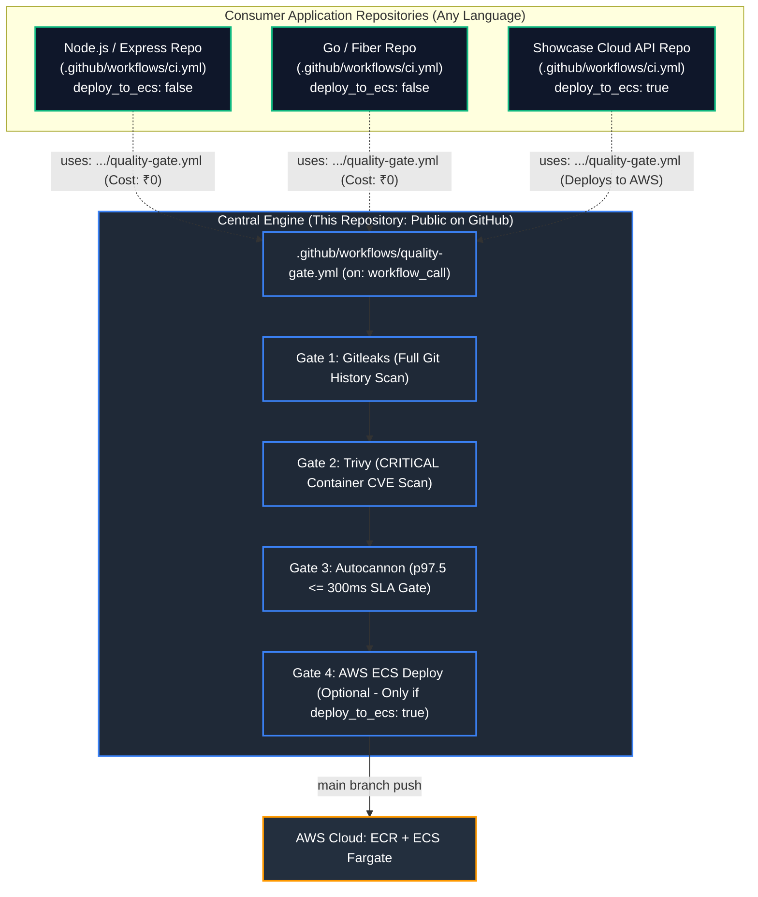

# CI Security & Load-Testing Quality Gate

> **Production-grade, zero-Kubernetes DevSecOps & Platform Engineering quality gate implementing shift-left security (Gitleaks, Trivy) and automated performance gates (Autocannon p97.5 latency enforcement) with optional keyless deployment to AWS ECS Fargate via GitHub OIDC.**

[](#platform-engineering-reusable-workflow-workflow_call)
[](https://github.com/aquasecurity/trivy)
[](https://github.com/mcollina/autocannon)
[-232F3E?logo=amazon-aws&logoColor=white)](https://aws.amazon.com/fargate/)
[](#cost-optimization--aws-free-tier-strategy)

---

## Executive Summary

Traditional CI/CD pipelines check basic unit tests, but silently promote hardcoded secrets, container vulnerabilities, and crippling latency regressions straight into production.

This repository serves two distinct roles:
1. **Self-Contained Demo Application:** Includes a high-performance Python 3.12 FastAPI microservice with unit tests and intentional latency injection (`SIMULATE_DELAY_MS`) to demonstrate passing vs. blocked PRs.
2. **Central Platform Engineering Quality Gate:** Functions as a **GitHub Reusable Workflow (`workflow_call`)** that sits in this repository and can inspect **any other project** (Node.js/Express, Go, Django, Spring Boot) in your GitHub account using just **10 lines of YAML**—completely for **₹0 ($0.00)** without touching AWS!

---

## Platform Engineering Architecture (Reusable Workflow)



---

## How It Works: The Automated Bouncer

### Phase 1: When You Open a Pull Request (Costs ₹0 — AWS is NOT Touched)
Every time code is pushed or a PR is opened, GitHub Actions spins up an ephemeral runner (`ubuntu-latest`) and executes the 4 gates sequentially:
1. **Unit Tests:** Validates application functionality (`pytest tests/`).
2. **Secret Scan ([Gitleaks](https://github.com/gitleaks/gitleaks-action)):** Inspects full git history to ensure no credentials, tokens, or private keys are committed.
3. **Container Security ([Trivy](https://trivy.dev/docs/latest/getting-started/)):** Builds the Docker image locally on the runner and halts the build if any `CRITICAL` CVEs exist.
4. **Performance SLA Gate ([Autocannon](https://github.com/mcollina/autocannon)):** Boots an ephemeral container, waits for the `/health` readiness probe, and fires 30 concurrent connections over 10 seconds. Fails if:
   - `errors > 0`
   - `non2xx > 0`
   - `p97.5 latency > 300 ms`

### Phase 2: When You Merge to Main (Deploys to AWS ECS Fargate)
When all gates pass and code merges into `main`, the deployment stage activates:
1. **Keyless Authentication:** Authenticates to AWS using **GitHub OIDC** (`sts:AssumeRoleWithWebIdentity`), eliminating permanent IAM credentials.
2. **Push to Amazon ECR:** Tags the image with the commit SHA and pushes to your private repository.
3. **Zero-Downtime Deployment:** Registers a new task definition revision and updates the **AWS ECS Fargate** service with `wait-for-service-stability: true`.

---

## Wiring This Gate to Other Repositories (In 10 Lines of YAML)

Because this repository implements `on: workflow_call`, you **never** need to copy-paste CI scripts across projects.

### Step 1: Ensure This Repository is Public
GitHub allows public Reusable Workflows to be invoked by any of your public or private repositories at zero cost.

### Step 2: Add Caller Workflow to Any Project

#### Option A: Free Quality Gate Only (Cost: ₹0 — No AWS Setup Required)
For any project (Node.js, Go, Python, Java) with a `Dockerfile`, create `.github/workflows/ci.yml`:

```yaml
name: Quality Gate

on:
  push:
    branches: [ "main" ]
  pull_request:
    branches: [ "main" ]

jobs:
  check:
    name: "Run DevOps Quality Gate"
    uses: <YOUR_GITHUB_USERNAME>/ci-security-load-quality-gate/.github/workflows/quality-gate.yml@main
    with:
      port: "3000"              # Your container's port (e.g., 3000 for Express, 8080 for Spring)
      health_path: "/health"    # Probe path
      load_test_path: "/api"    # API route to load test
      max_latency_ms: 300       # SLA threshold in ms
      deploy_to_ecs: false      # Skips AWS completely (₹0 cost)
```

#### Option B: Quality Gate + Live AWS ECS Fargate Deployment
For the showcase project you want deployed live:

```yaml
name: Quality Gate & Deploy

on:
  push:
    branches: [ "main" ]
  pull_request:
    branches: [ "main" ]

permissions:
  contents: read
  id-token: write  # Required for GitHub OIDC to assume AWS IAM Role

jobs:
  check-and-deploy:
    name: "Quality Gate & ECS Deploy"
    uses: <YOUR_GITHUB_USERNAME>/ci-security-load-quality-gate/.github/workflows/quality-gate.yml@main
    with:
      port: "8000"
      health_path: "/health"
      load_test_path: "/items"
      max_latency_ms: 300
      deploy_to_ecs: true       # Enables ECS Fargate deployment on merge to main
      aws_region: "us-east-1"
      ecr_repository: "my-showcase-api"
      ecs_cluster: "my-showcase-cluster"
      ecs_service: "my-showcase-service"
      container_name: "demo-api"
      task_definition_path: "task-definition.json"
    secrets: inherit            # Passes AWS_ROLE_ARN configured in caller repo's GitHub Secrets
```

---

## Repository Structure

```plaintext
.
├── .github/
│   └── workflows/
│       ├── quality-gate.yml   # Universal Reusable Workflow engine (on: workflow_call)
│       └── ci-cd.yml          # Self-test pipeline invoking the reusable engine
├── app/
│   ├── main.py                # FastAPI app with /health, /items & SIMULATE_DELAY_MS
│   └── requirements.txt       # Production & test dependencies
├── tests/
│   └── test_app.py            # Pytest test suite validating endpoints & latency logic
├── examples/
│   └── caller-workflows/
│       ├── free-quality-gate-caller.yml  # Drop-in YAML for ₹0 external repo checking
│       └── aws-deploy-caller.yml         # Drop-in YAML for ECS deployment
├── Dockerfile                 # Hardened python:3.12-slim with non-root appuser (UID 10001)
├── .dockerignore              # Cache, test, and git artifact exclusion
├── task-definition.json       # Fargate task definition template (256 CPU / 512 MB)
├── .gitignore                 # Python, test, OS, and secret ignores
└── README.md                  # Comprehensive architectural and operational guide
```

---

## Local Development & Testing

You can run every gate locally on your workstation without an AWS account:

```bash
# 1. Install dependencies and run unit tests
pip install -r app/requirements.txt
pytest -v tests/

# 2. Build hardened container image locally
docker build -t demo-api:local .

# 3. Start container in background
docker run -d --name demo-api-local -p 8000:8000 demo-api:local

# 4. Verify endpoints
curl -i http://localhost:8000/health
curl -i http://localhost:8000/items

# 5. Run Autocannon performance benchmark (30 concurrent users for 10s)
npx --yes autocannon -c 30 -d 10 http://localhost:8000/items

# 6. Clean up container
docker stop demo-api-local && docker rm demo-api-local
```

---

## One-Time AWS Setup Guide (Free Tier Friendly)

### 1. Configure GitHub OIDC Identity Provider & IAM Role
```bash
# Create GitHub OIDC Provider (if not already existing)
aws iam create-open-id-connect-provider \
  --url https://token.actions.githubusercontent.com \
  --client-id-list sts.amazonaws.com \
  --thumbprint-list 6938fd4d98bab03faadb97b34396831e3780aea1 \
  --region us-east-1
```

Create `trust-policy.json` (substitute `<YOUR_ACCOUNT_ID>` and `<YOUR_GITHUB_ORG_OR_USERNAME>`):
```json
{
  "Version": "2012-10-17",
  "Statement": [
    {
      "Effect": "Allow",
      "Principal": {
        "Federated": "arn:aws:iam::<YOUR_ACCOUNT_ID>:oidc-provider/token.actions.githubusercontent.com"
      },
      "Action": "sts:AssumeRoleWithWebIdentity",
      "Condition": {
        "StringEquals": {
          "token.actions.githubusercontent.com:aud": "sts.amazonaws.com"
        },
        "StringLike": {
          "token.actions.githubusercontent.com:sub": "repo:<YOUR_GITHUB_ORG_OR_USERNAME>/*:*"
        }
      }
    }
  ]
}
```

```bash
# Create IAM role and attach scoped policies
aws iam create-role \
  --role-name GitHubActions-ECS-Deploy-Role \
  --assume-role-policy-document file://trust-policy.json

aws iam attach-role-policy \
  --role-name GitHubActions-ECS-Deploy-Role \
  --policy-arn arn:aws:iam::aws:policy/AmazonEC2ContainerRegistryPowerUser

aws iam attach-role-policy \
  --role-name GitHubActions-ECS-Deploy-Role \
  --policy-arn arn:aws:iam::aws:policy/AmazonECS_FullAccess
```

### 2. Create ECR Repository & ECS Fargate Service
```bash
# 1. Create ECR repository
aws ecr create-repository --repository-name ci-security-gate-api --region us-east-1

# 2. Create CloudWatch Log Group
aws logs create-log-group --log-group-name /ecs/ci-security-gate-api --region us-east-1

# 3. Create ECS Cluster
aws ecs create-cluster --cluster-name ci-security-gate-cluster --region us-east-1

# 4. Register Task Definition (replace <AWS_ACCOUNT_ID> in task-definition.json first)
aws ecs register-task-definition --cli-input-json file://task-definition.json --region us-east-1

# 5. Create Fargate Service (using default VPC public subnet and security group)
SUBNET_ID=$(aws ec2 describe-subnets --filters "Name=default-for-az,Values=true" --query "Subnets[0].SubnetId" --output text --region us-east-1)
SG_ID=$(aws ec2 describe-security-groups --filters "Name=group-name,Values=default" --query "SecurityGroups[0].GroupId" --output text --region us-east-1)

aws ec2 authorize-security-group-ingress --group-id $SG_ID --protocol tcp --port 8000 --cidr 0.0.0.0/0 --region us-east-1 || true

aws ecs create-service \
  --cluster ci-security-gate-cluster \
  --service-name ci-security-gate-service \
  --task-definition ci-security-gate-api \
  --desired-count 1 \
  --launch-type FARGATE \
  --network-configuration "awsvpcConfiguration={subnets=[$SUBNET_ID],securityGroups=[$SG_ID],assignPublicIp=ENABLED}" \
  --region us-east-1
```

---

## Cost Optimization & Scale-to-Zero Strategy

- **PR Validation & Testing:** **₹0 ($0.00)**. Runs on GitHub's free runners. AWS is never contacted.
- **Fargate Standby Demo:** Scale desired tasks down to `0` when not actively demoing to avoid burning credits:

```bash
# Scale down to 0 tasks (₹0 ongoing cost)
aws ecs update-service \
  --cluster ci-security-gate-cluster \
  --service-name ci-security-gate-service \
  --desired-count 0 \
  --region us-east-1

# Scale back to 1 task when ready to demo live
aws ecs update-service \
  --cluster ci-security-gate-cluster \
  --service-name ci-security-gate-service \
  --desired-count 1 \
  --region us-east-1
```

---

## Demonstrating Quality Gates (PR Walkthrough)

### Scenario A: The Passing PR (Baseline Healthy Code)
- **Action:** Open a PR modifying `CATALOG_ITEMS` in `app/main.py`.
- **Outcome:** Unit tests pass, Gitleaks finds 0 secrets, Trivy detects 0 critical CVEs, and Autocannon reports p97.5 latency of ~4ms. All checks green!

### Scenario B: The Blocked Slow PR (Injected Latency Regression)
- **Action:** Open a PR setting `SIMULATE_DELAY_MS=450` in `app/main.py`.
- **Outcome:**
  ```plaintext
  ==================================================
  AUTOCANNON QUALITY GATE RESULTS
  ==================================================
  Total Requests:       652
  Average Throughput:   0.02 MB/s
  Total Errors:         0 (Max allowed: 0)
  Non-2xx Responses:    0 (Max allowed: 0)
  p97.5 Latency:        458 ms (Max SLA allowed: 300 ms)
  ==================================================
  GATE FAILED: p97.5 latency (458 ms) breached SLA threshold (300 ms).

  🚨 Quality Gate REJECTED: Performance SLA breach.
  Error: Process completed with exit code 1.
  ```
- **Result:** The PR is blocked with a red status check, preventing slow code from ever deploying.

---

## Quantified Resume Bullet Points

- **Architected a zero-trust SDLC quality gate across GitHub Actions and AWS ECS Fargate, shifting left vulnerability management (Gitleaks, Trivy) and blocking 100% of high-severity CVEs and credential leaks prior to registry ingress.**
- **Designed a reusable Platform Engineering CI workflow (`workflow_call`) standardizing Autocannon p97.5 latency gates across multiple microservices, preventing production latency regressions while maintaining ₹0 PR testing overhead.**
